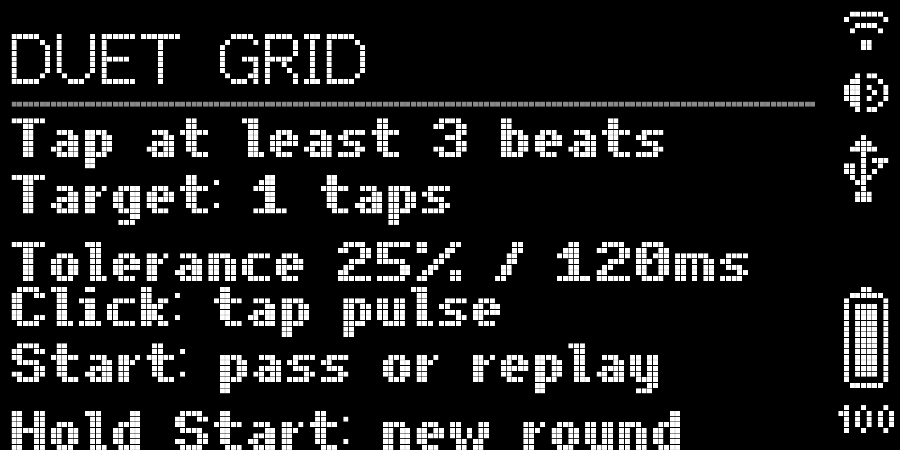

# Duet Grid

Trade short rhythms between two players, then reproduce the full pulse sequence by tapping.

Hand the same instrument across the desk for a rhythm game. The second player must remember the spaces between taps, so getting the number of beats right is only half the challenge.

During composition, each column records a gap between two taps. When the bar changes hands, the second player sees empty positions fill with their own rhythm. A missed interval turns red.

## Screen transitions

Place notes in the call and follow the answer during playback.


<details>

<summary>Watch the rear display</summary>



</details>

## Compose a short call

1. Hold **Start** for a fresh round. Player one clicks the wheel at least three times. Use an easy-to-remember phrase such as two short beats followed by a longer gap.
2. Read the beat count on **Compose**. Press **Start** after the final tap to pass the phrase to player two.
3. Hand over the bar when the front changes to **Echo**. The denominator is the number of intervals to match.


## Play back the answer

1. Player two clicks the rhythm from memory. The first click sets the starting moment. Each later click supplies an interval.
2. Watch the count advance. A correct response ends at **Passed / Matched**. A missed interval ends the attempt; press **Start** for another try.
3. After a match, press **Start** and tap twice to extend the phrase by one interval. Pass it back again.


## Example from the emulator

Three taps contain two intervals. For an interval of 800 ms, the allowed difference is 200 ms. For a short interval of 300 ms the allowance is 120 ms. The game uses the larger of 25% or 120 ms for each gap.

## Run in the emulator

Open BUSY Bar Emulator. From this repository, run:

```sh
~/.busy-emulator/bin/busy-emulator dev --once
```

Press **Back** to exit.

The GIFs are excerpts from the emulator recording. Each LED occupies a 16 × 16 cell with a black border. The end frames pause for reading.

[Full recording](media/controls.mp4) · [Rear display](screenshots/back-1.png) · [Firmware test](EMULATOR-QA.md) · [MIT license](LICENSE)
